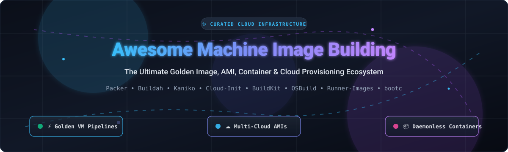

# 🚀 Awesome Machine Image Building

  

  
  
  
  
  
  
  

---

## 🌟 Top Machine Image Building Ecosystem

**Curated List of Production-Grade SaaS Platforms & Open-Source GitHub Projects for Automated Machine Images, Golden AMIs, OCI Containers & Virtual Machine Provisioning.**

*Focused on Golden Image Pipelines, Multi-Cloud Provisioning, Immutable Infrastructure & Self-Hosted Build Tooling.*

📅 **Last updated: October 2026**

---

### 📖 Overview & SEO Summary

This repository indexes the world's most robust **SaaS platforms** and **open-source developer tools** for **Machine Image Building**, **Golden Image Automation**, and **Virtual Machine Image Pipelines**. In modern cloud engineering and DevOps, reproducible machine images (cloud AMIs, Azure VHDs, Google Compute Engine images, VMware VMDKs, OpenStack qcow2, and daemonless OCI/Docker containers) form the foundation of secure, immutable infrastructure.

Whether you are seeking:
- **Multi-Cloud VM Image Automation** (HashiCorp Packer, Red Hat Image Builder)
- **Container-Native Image Builders** (Kaniko, BuildKit, Buildah, ko)
- **Instance Cloud Initialization & First-Boot Customization** (cloud-init)
- **Bare-Metal & Operating System Composition** (osbuild, diskimage-builder, bootc-image-builder)
- **Continuous Integration VM Runner Provisioning** (actions/runner-images)

This directory serves as an authoritative guide for platform engineers, SREs, and DevOps architects seeking to eliminate configuration drift and accelerate CI/CD build pipelines.

---

## 📑 Table of Contents

- [📊 Sector Overview & Market Dynamics](#-sector-overview--market-dynamics)
- [☁️ SaaS & Hosted Platforms](#️-saashosted-platforms)
- [🛠️ Open-Source GitHub Projects](#️-open-source-github-projects)
- [📈 Star History](#-star-history)
- [🤝 How to Contribute](#-how-to-contribute)
- [💖 Support](#-support)
- [⚠️ Disclaimer](#️-disclaimer)

---

## 📊 Sector Overview & Market Dynamics

The machine image building and golden image automation space forms a core segment of the Infrastructure as Code (IaC) and cloud automation market, estimated at approximately **$1.5B to $2.0B in 2025–2026** and projected to surpass **$6B+ by 2030** (growing at ~24% CAGR). The market exhibits a **moderately concentrated, bifurcated structure**: hyperscale cloud providers (Microsoft, Amazon, Red Hat/IBM) capture native platform workloads with proprietary builders, while HashiCorp/IBM dominates multi-cloud golden image provisioning alongside open-source standards.

---

## ☁️ SaaS/Hosted Platforms

| Product | Company Scale (Valuation / Revenue) | Description | Pricing | Free Tier Limit |
| :--- | :--- | :--- | :--- | :--- |
| **[Azure VM Image Builder](https://azure.microsoft.com/en-us/products/image-builder/)** | **~$3.1 Trillion** market cap / **~$245B** annual revenue (Microsoft) | Managed service built on HashiCorp Packer for creating Linux and Windows images with Azure-specific customizations (Sysprep, Compute Gallery integration). | **$0 service fee** (Compute build resources start at **$0.096/hour** for Standard_D1_v2 VM + temporary storage & egress) | **30-day free trial** with **$200 credit**; no permanent free tier for consumed compute/storage |
| **[AWS EC2 Image Builder](https://aws.amazon.com/image-builder/)** | **~$2.0 Trillion** market cap / **~$600B+** annual revenue (Amazon) | Managed service for building, testing, and distributing AMIs and container images with automated patching pipelines. | **$0 service fee** (Underlying resources billed at standard rates; e.g., t3.micro at **~$0.0104/hour** + **$0.08/GB-month** gp3 EBS) | **Free forever under AWS Free Tier**: **750 hours/month** of t2.micro/t3.micro EC2 and **30 GB** EBS storage |
| **[Red Hat Image Builder](https://console.redhat.com/insights/image-builder)** | **~$34 Billion** acquisition by IBM (Parent IBM: **~$200B+** market cap / **~$62B** revenue) | Hosted service for creating RHEL-based images (AWS AMIs, Azure VHDs, VMware VMDKs, qcow2) with automatic patching and compliance profiles. | Included with RHEL subscriptions; RHEL Server self-support tier starts at **$383.90/year** (or standard support at **$878.90/year**) | **Free forever** via **Red Hat Developer Subscription for Individuals** (allows up to **16 physical or virtual nodes** for dev/testing) |
| **[HCP Packer](https://www.hashicorp.com/products/packer)** | **~$6.4 Billion** acquisition valuation by IBM (Parent IBM: **~$200B+** market cap / **~$62B** revenue) | HashiCorp's managed registry for tracking Packer image metadata, lifecycle management, and Terraform integration. | **Essentials tier** starts at **$0.010/hour per image bucket** (~$7.30/bucket/month) + **$0.011/request**; Standard tier at **$0.034/hour per image bucket** | **$500 platform trial credit** (valid across HCP services on pay-as-you-go; no permanent free-forever SaaS tier) |

---

## 🛠️ Open-Source GitHub Projects

*Sorted by GitHub Star Counts (Descending)* 🌟

- **[Packer](https://github.com/hashicorp/packer)**   
  📦 **The multi-cloud machine image standard.** Builds identical machine images for AWS, Azure, GCP, VMware, VirtualBox, Docker, and more from a single HCL or JSON template. Features parallel builds across platforms, external plugin integrations, and HCP Packer integration for image lifecycle tracking. Best for teams requiring a single unified tool to produce golden images across multiple clouds and on-premise hypervisors.

- **[Kaniko](https://github.com/GoogleContainerTools/kaniko)**   
  ☸️ **The Kubernetes-native container builder.** Builds container images from a Dockerfile inside a container or Kubernetes cluster without requiring root privileges or a Docker daemon. Extracts base image filesystems, executes Dockerfile commands, snapshots changes in userspace, and pushes to a container registry. Best for CI/CD pipelines running in Kubernetes where mounting a Docker socket is prohibited.

- **[Runner-Images](https://github.com/actions/runner-images)**   
  🏃 **GitHub Actions virtual machine runner images.** Official open-source repository containing Packer templates and deployment automation scripts used to build and provision the official virtual machine images (Ubuntu, macOS, Windows) for GitHub Actions hosted runners. Best for platform engineering teams replicating self-hosted GitHub Actions runners with identical toolchains.

- **[BuildKit](https://github.com/moby/buildkit)**   
  ⚡ **Concurrent, cache-efficient, Dockerfile-agnostic builder toolkit.** High-performance backend engine that powers modern `docker build` and standalone container construction. Features parallel build graph solver, fine-grained multi-stage caching, rootless execution, secrets mount support, and modular frontend parsers.

- **[Buildah](https://github.com/containers/buildah)**   
  🛡️ **The daemonless OCI container image builder.** Builds standard OCI container images without requiring root privileges or a running daemon using a clean fork-exec model. Uniquely capable of building container images with or without Dockerfiles directly via standard shell scripting and Unix CLI utilities.

- **[ko](https://github.com/ko-build/ko)**   
  🐹 **Simple, fast container image builder for Go applications.** Builds, packages, and pushes secure, minimal OCI-compliant container images without requiring Docker or any daemon. Operates directly on Go source code, automatically layering dependencies on top of distroless base images with zero Dockerfile configuration.

- **[cloud-init](https://github.com/canonical/cloud-init)**   
  🌐 **The universal instance initialization layer.** The de facto industry standard for early-stage boot configuration across cloud providers—handling network configuration, user creation, SSH key injection, package installation, and custom scripts. Typically baked directly into golden machine images via Packer to allow dynamic instance self-configuration.

- **[Kubernetes Image-Builder](https://github.com/kubernetes-sigs/image-builder)**   
  ⚙️ **Kubernetes VM image building tooling for Cluster API.** Maintained by the Kubernetes Special Interest Group (SIGs), this project provides automated Packer and Ansible templates to build production-ready VM images across 18+ infrastructure providers (AWS, Azure, GCP, vSphere, OpenStack, Nutanix) across Ubuntu, Flatcar, Rocky Linux, and RHEL.

- **[bootc-image-builder](https://github.com/osbuild/bootc-image-builder)**   
  🔄 **Containerfile to bootable disk image generator.** Transforms container images built with `bootc` (such as CentOS Stream / RHEL Image Mode) into bootable disk artifacts, including AWS AMIs, RAW disk images, ISO installers, and QCOW2 virtual disks. Enables pure container-native OS delivery.

- **[diskimage-builder](https://github.com/openstack/diskimage-builder)**   
  📂 **The OpenStack disk image composition toolkit.** A modular suite of tools for building disk images, filesystem images, and ramdisks for OpenStack and bare-metal nodes. Uses an element-based modular architecture to inject software packages, configurations, and post-installation hooks into AlmaLinux, Debian, Fedora, RHEL, Rocky Linux, and Ubuntu disks.

- **[osbuild](https://github.com/osbuild/osbuild)**   
  🏗️ **The modular engine behind Red Hat Image Builder.** A group of applications and APIs designed for assembling deterministic, isolated Linux operating system images ready for public cloud providers, private hypervisors, and raw hardware media.

---

## 📈 Star History

---

## 🤝 How to Contribute

1. 🍴 Fork the repository.
2. 📝 Add or update entries in `README.md` (keep entries factual, objective, and follow the existing format).
3. 🔗 Include: name, official link, GitHub star badge, concise 1–2 sentence description, and primary use cases.
4. 🚀 Submit a Pull Request with a clear description of your additions!

⭐️ **Star the repo** if you find it helpful for your cloud & DevOps stack!

---

## 💖 Support

Thank you for exploring and supporting **Awesome-Machine-Image-Building**! 

If you found this curated ecosystem helpful in designing your golden image pipelines, provisioning cloud environments, or selecting build tooling:
- ⭐️ **Star this repository** to help others discover it.
- 🍴 **Fork and contribute** to keep the community list comprehensive and up-to-date.
- 📢 **Share with your network**—colleagues, DevOps teams, SREs, and cloud architects.
- ☕ **Buy me a coffee / Sponsor**: If you'd like to support ongoing maintenance and research, consider sponsoring via the [GitHub Sponsor Dashboard](https://github.com/sponsors/ishandutta2007).

Every bit of support is deeply appreciated! 🙌

---

## ⚠️ Disclaimer

- 📌 This is a **community-curated list** — not exhaustive and not an endorsement of specific vendors.
- 💰 **Managed cloud image builders consume billable resources**: AWS EC2 Image Builder, Azure VM Image Builder, and Red Hat Image Builder do not charge a separate software license fee, but underlying compute, network egress, and disk storage are billed at standard cloud rates.
- 📋 **Red Hat Image Builder requirements**: The no-cost Red Hat Developer Subscription is intended for development and testing workloads only; production usage requires an active commercial RHEL subscription.
- 🔒 **Container Builder Limitations**: Builders like Kaniko and Buildah operate differently from standard Docker daemons (e.g., Kaniko lacks Windows container support); verify compatibility prior to production CI/CD adoption.
- 🔌 **Packer Plugin Maintenance**: HashiCorp Packer community plugins vary in maintenance status—always review plugin repository activity before building mission-critical pipelines.

---

  <b>Built for platform engineers, SREs, and DevOps architects creating reproducible, hardened machine images.</b> 
  <i>Empowering multi-cloud, immutable, and automated infrastructure everywhere.</i>

